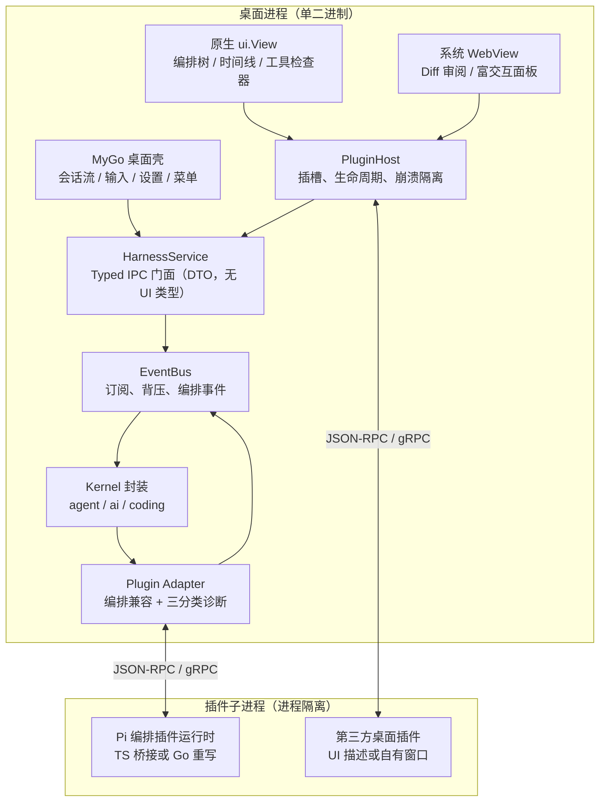

# 架构 01：总体架构

- 状态：定稿
- 日期：2026-10-28
- 关联：ADR-0001 ~ 0007；architecture/02、03、04、05；research/01、03

## 1. 一句话

**Go 内核负责“做事”，MyGo 宿主负责“看得见”，适配层负责“把 pi 的编排语义接进来”，插件在明确的边界里长界面。**

pi 的行为是契约；`sky-valley/pi` 是内核实现；我们只写内核与界面之间的那一层，以及界面本身。

## 2. 分层总览

## 3. 依赖方向（只允许向下）

1. `cmd/locowrk` 只装配，不含业务逻辑。
2. `desktop/` 可以 import `internal/bridge` 暴露的 DTO 与接口，**不得**直接 import `internal/kernel`。
3. `internal/bridge` 依赖 `internal/kernel`、`internal/eventbus`、`internal/adapter`，并向 `desktop/` 暴露与 UI 框架无关的接口。
4. `internal/kernel` 封装 `github.com/sky-valley/pi` 的 `agent`、`ai`、`coding`；它是唯一知道上游 API 形状的地方。
5. `internal/adapter` 依赖事件契约与子进程协议，不依赖 MyGo。
6. 任何 `internal/` 包都不得 import `github.com/egoist/mygo` 或 `.../mygo/ui`。

> 检查点：`go list -deps ./internal/... | grep egoist/mygo` 必须为空。后续用脚本固化。

## 4. 运行时形态

- **一个桌面二进制**：MyGo 应用、内核、事件总线、适配层同进程。
- **N 个插件子进程**：编排插件与第三方桌面插件按需启动；宿主负责心跳、超时、重启与资源上限。
- **两种界面路径**：主壳与原生插件用 `ui.View`；富交互面板用系统 WebView。同一窗口可混合（MyGo 支持网页嵌在原生界面之下、弹层覆盖其上）。
- **一条事件流**：内核产生的 `agent.AgentEvent` 被包装为项目事件，经 EventBus 分发给 UI 与适配器；UI 不反向读取内核内部状态。

## 5. 技术栈

| 用途 | 选型 | 说明 |
|---|---|---|
| 语言 | Go 1.27+ | 与 `sky-valley/pi`（go 1.26）和 MyGo（1.27.3+）取交集 |
| Agent 内核 | `github.com/sky-valley/pi` | 固定提交；见 research/01 |
| 桌面宿主 | `github.com/egoist/mygo` v0.7.x | 原生 `ui` + 系统 WebView + Typed IPC |
| 进程协议 | JSON-RPC 2.0 over stdio（首选） | gRPC 仅在需要双向流/多语言时引入 |
| 会话 | 上游 JSONL | 复用 `coding` 的写入/恢复 |
| 前端资产 | TypeScript + 任意打包器 | 仅 WebView 路径使用 |
| 测试 | `go test -race` + MyGo 无窗口视图测试 | 协议用 fixture 回放 |

## 6. 与立项方案的对应

| 方案章节 | 规范化位置 |
|---|---|
| 二、总体架构 | 本文 |
| 四、Go 内核层 | architecture/02 |
| 五、插件适配层 | architecture/04 §2 |
| 六、桌面插件宿主与渲染 | architecture/04 §3~§5 |
| 七、目录结构与依赖 | standards/01；本文 §3 |
| 八、分阶段路线图 | roadmap/00 + phase-1 ~ phase-7 |
| 九、关键风险 | roadmap/00 §4 + architecture/03 |

## 7. 里程碑形态

- **Phase 1 末**：命令行能跑通一次完整工具调用，事件序列正确，会话可恢复。
- **Phase 2 末**：mock 编排插件能被子进程拉起，编排事件可见；TUI 调用 no-op + 诊断，主流程不中断。
- **Phase 3 末**：MyGo 窗口实时显示 Agent 输出，输入框可发消息，空闲 CPU 接近 0。
- **Phase 4 末**：原生 `ui.View` 插件挂进插槽，可独立启停，元素生命周期断言通过。
- **Phase 5 末**：WebView Diff 面板与原生控件并列，切换 tab 不丢页面状态。
- **Phase 6 末**：真实 Pi 编排插件（parallel/chain/async）在桌面端可见，steering 可回传。
- **Phase 7 末**：一个独立进程的第三方插件能挂载面板，崩溃不拖垮宿主。
