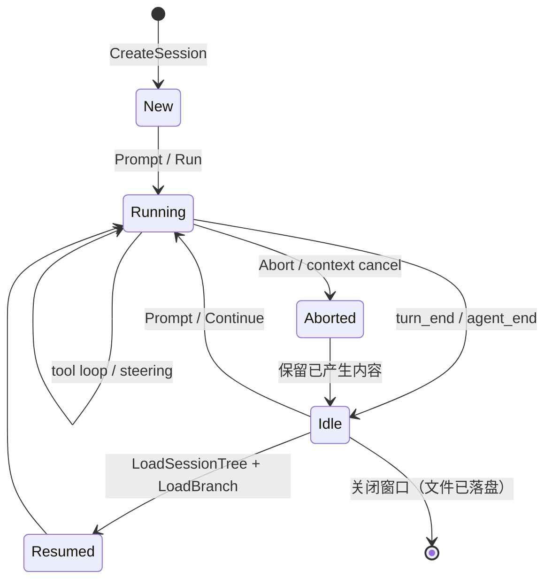

# 架构 05：会话、资源与凭证

- 状态：定稿
- 日期：2026-10-28
- 关联：ADR-0005；architecture/02、03；research/01

## 1. 会话格式：沿用上游，不另立

`sky-valley/pi` 的 `coding` 包已经实现与 pi 兼容的**追加式 JSONL**：

- 目录：`~/.pi/agent/sessions/--<编码后的 cwd>--/`（`coding.DefaultSessionDir`）。
- 文件：首行是会话头（id、时间、cwd、模型等），其后每行一个 entry；只追加，不改写历史。
- entry 类型：消息、工具结果、模型切换、思考档、压缩、`context_edit` 等；上游带 v1→v3 迁移。
- 恢复：`coding.ResumeSession`、`LatestSession`、`FindSessionByID`、`LoadSessionTree` + `Session.LoadBranch`。
- 写入时机：会话在首条用户消息时落盘（与上游一致），空会话不产生文件。

**决定**：本项目不定义第二套会话格式。桌面端、插件、导出功能都通过 `coding` 的 API 读写。理由与后果见 ADR-0005。

## 2. 会话生命周期

- **恢复**：打开历史会话时加载投影（compaction、`context_edit` 已应用），UI 看到的是“当前上下文”，原始历史仍保留。
- **分叉**：上游 `SessionTree` 支持从某个 entry 分支；UI 的“从这里继续”走它，不复制文件。
- **压缩**：达到阈值时上游自动压缩并写入压缩 entry；桌面端只展示“已压缩”标记与摘要，不自己算 token。
- **删除/归档**：删除文件属于用户显式操作；首版只做“在列表中隐藏”，不自动清理。

## 3. 项目上下文与技能

### 3.1 项目上下文文件

上游 `coding.LoadProjectContextFiles` 从 cwd 向上发现 `AGENTS.md` / `CLAUDE.md`，`AGENTS.override.md` 在其目录内覆盖两者。内容拼进系统提示词。

- 桌面端显示“本会话加载了哪些上下文文件”，让用户可核对。
- 修改这些文件不自动重载当前会话；下一轮或新会话生效（与上游一致），UI 明确提示。

### 3.2 技能

- 用户级：`~/.pi/agent/skills/*/SKILL.md`。
- 项目级：`<cwd>/.pi/skills/*/SKILL.md`，**默认不加载**；`SessionOptions.TrustProject` 为 true 才扫描（上游 headless 默认）。
- 发现后会校验 frontmatter（name/description），非法项产生诊断；系统提示词按预算注入技能名与描述。
- 桌面端提供“查看已加载技能”“信任此项目”“撤销信任”。

### 3.3 提示词模板（缺口）

上游 pi 有 prompt templates，`sky-valley/pi` **尚未移植**。本项目：

- Phase 1~6 不承诺模板功能；
- 若需要，先在 `internal/kernel` 实现发现与 `$@` 展开，再写 ADR 与测试；
- 不假装兼容，不在文档中把它列为已支持能力。

## 4. 数据目录与配置

| 内容 | 位置 | 写入方 |
|---|---|---|
| 会话 | `~/.pi/agent/sessions/` | `coding` |
| 用户技能 | `~/.pi/agent/skills/` | 用户/插件安装器 |
| 桌面设置 | `~/.pi/desktop/settings.json`（计划） | 桌面壳 |
| 凭证引用 | 设置文件中的 `keyRef` | 桌面壳 |
| 凭证本体 | 系统钥匙串（MyGo Secrets） | 桌面壳 |
| 插件 | `~/.pi/desktop/plugins/<name>/`（计划） | 插件管理器 |
| 日志 | `~/.pi/desktop/logs/`（计划） | 桌面壳，滚动上限 |

- 目录由上游 `coding.AgentDir()` 决定：固定为用户主目录下的 `.pi/agent`（`ConfigDirName = ".pi"`），**不提供环境变量覆盖**。测试/开发通过临时主目录隔离（设置 `HOME`/`USERPROFILE`），不得写用户真实数据。
- 便携模式（数据放程序目录）留 backlog。

## 5. 凭证

- API key 只进系统钥匙串；设置文件只存 `keyRef` 与 provider/model 元数据。
- 也支持环境变量（`ANTHROPIC_API_KEY` 等）作为开发/CI 路径；UI 明示来源。
- 日志、事件、插件协议、崩溃报告统一脱敏：key、token、`Authorization`、`*_API_KEY` 值。
- 钥匙串不可用时 fail-closed：提示用户，不回退到明文文件。

## 6. 导出与互操作

- 会话导出为 Markdown/JSON 由 `coding` 的投影数据生成，不直接拷贝 JSONL（避免把内部 entry 当公开格式）。
- 导入：只支持上游 JSONL 会话；导入前校验头部与 entry 类型，未知类型降级为诊断，不崩溃。
- 与 pi CLI 互操作：同一会话目录、同一格式，pi 与 Locowrk 可以互相恢复（这是选择上游格式的直接收益）。

## 7. 隐私

- 默认零遥测、零上报；崩溃报告只在用户点击后生成，且先展示将发送的内容。
- 会话内容属于用户；插件读取会话必须经宿主 API，并受能力声明限制。
- 删除会话即删除文件；备份/回收站行为由操作系统决定，UI 要说清楚。
