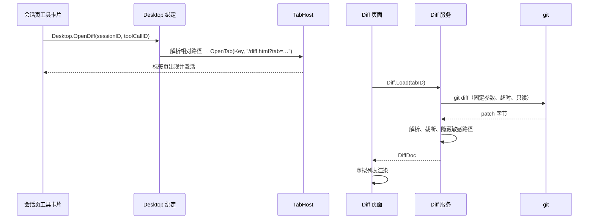

# 设计：Phase 5 Diff 审阅插件

- 状态：定稿
- 日期：2026-10-28
- 关联：ADR-0014；[webview.md](webview.md)；roadmap/phase-5；standards/06；research/03 §10

## 1. 目标与非目标

**目标**：从工具卡片或宿主菜单打开工作区的未暂存 diff，Go 侧只读取得并解析，前端并排/统一渲染；10,000 行 diff 在 1 秒内可用；大文件截断、敏感路径隐藏；切换标签页后滚动与视图模式保持。

**不做**：编辑、暂存/提交、逐文件历史、blame、搜索、实时监听文件变化、跨仓库、未跟踪文件、三方合并、远程仓库浏览。未暂存之外的变化只在界面脚注说明，不提供切换。

## 2. 数据流



- 刷新按钮或 `⋯ › 刷新` 重复 `Diff.Load`；重复打开同一目标时宿主激活旧标签并发送 `diff-reload`，页面保留模式与滚动锚点。
- 不做实时推送；工具结束后用户主动打开或刷新。

## 3. 命令与工作区

- 工作区是 `desktop.Options.Cwd`（启动目录），只支持一个仓库；diff 限定在 `<cwd>` 之内（`-- .`），不显示上层仓库的其他目录。加载时先 `git -C <cwd> rev-parse --show-toplevel` 判断是否仓库并取根目录；失败则返回 `notRepo`/`noGit`。
- 正式命令（不经 shell，参数固定）：

```text
git -c core.quotepath=false -C <cwd> diff --no-color --no-ext-diff --no-textconv --unified=3 -- .
```

- 环境：`GIT_PAGER=cat`、`GIT_TERMINAL_PROMPT=0`、`GIT_OPTIONAL_LOCKS=0`（避免读操作写 index.lock）；不继承会改变输出的 `GIT_EXTERNAL_DIFF`/`GIT_DIFF_OPTS`，在 `cmd.Env` 中过滤。
- 只读：不 stage、不写文件、不跑 textconv/ext-diff；`--no-ext-diff` 与 `--no-textconv` 同时挡住仓库配置里的外部程序。
- 超时 5 秒；stdout 上限 **8 MiB**、stderr 上限 4 KiB；超限标记截断，不再读取。
- 只显示已跟踪文件的**未暂存**改动；`--cached`、未跟踪文件、`.git` 内部内容都不出现。界面脚注写明。
- 二进制文件、子模块、纯模式变化只显示文件行，不显示内容。

## 4. 解析与 DTO

Go 侧解析统一 diff，前端不做语义解析。支持的段：`diff --git`、`old/new mode`、`similarity index`、`rename from/to`、`new/deleted file mode`、`index`、`---/+++`、`@@`、`\ No newline at end of file`、`Binary files … differ`、`GIT binary patch`。

- 路径优先取 `---`/`+++`（去掉前缀与制表符后的时间戳，处理 C 风格引号）；rename 用 `rename from/to`；最后才回退 `diff --git`。
- 行号从 hunk header 计算并校验；header 非法时跳过该文件并计入 `skipped`，不让整个文档失败。
- 文本统一 `strings.ToValidUTF8(…, "�")`，去掉行尾 `\r`；单行超过 2,000 字符截断并加“…”；单路径超过 300 字符截断。
- 上限：**200 个文件、20,000 行、8 MiB patch**；DTO 再按累计文本字节 **4 MiB** 预算提前截断，避免 JSON 过大；先到先截断，`Truncated=true`、`Reason` 说明是哪一项。
- 敏感路径（`.env`、`.env.*`、`.ssh/`、`id_rsa*`、`id_ed25519*`、`.git/`、`*.pem`、`*.key`）不返回内容、不返回行，只累加 `Hidden`；界面显示“已隐藏 N 个敏感文件”。

```go
type DiffDoc struct {
    State     string     `json:"state"`     // ok|clean|notRepo|noGit|timeout|error
    Message   string     `json:"message,omitempty"`
    Workspace string     `json:"workspace"` // 工作区目录名，不是绝对路径
    Revision  string     `json:"revision,omitempty"` // HEAD 短哈希
    Focus     string     `json:"focus,omitempty"`    // 打开时定位的相对路径
    Hidden    int        `json:"hidden"`
    Skipped   int        `json:"skipped"`
    Truncated bool       `json:"truncated"`
    Reason    string     `json:"reason,omitempty"`
    Stats     DiffStats  `json:"stats"`
    Files     []DiffFile `json:"files"`
}

type DiffStats struct {
    Files     int `json:"files"`
    Additions int `json:"additions"`
    Deletions int `json:"deletions"`
    Lines     int `json:"lines"`
}

type DiffFile struct {
    Path    string     `json:"path"`
    OldPath string     `json:"oldPath,omitempty"`
    Status  string     `json:"status"` // modified|added|deleted|renamed|binary|mode
    Binary  bool       `json:"binary,omitempty"`
    Hunks   []DiffHunk `json:"hunks"`
}

type DiffHunk struct {
    Header   string     `json:"header"`
    OldStart int        `json:"oldStart"`
    OldCount int        `json:"oldCount"`
    NewStart int        `json:"newStart"`
    NewCount int        `json:"newCount"`
    Lines    []DiffLine `json:"lines"`
}

type DiffLine struct {
    Kind  string `json:"kind"` // context|add|del|meta
    OldNo int    `json:"oldNo,omitempty"`
    NewNo int    `json:"newNo,omitempty"`
    Text  string `json:"text"`
}
```

## 5. 打开、关闭与定位

- 工具卡片在工具结束后显示“查看变更”；点击 `stopPropagation()`，不展开卡片，调用 `Desktop.OpenDiff(sessionID, toolCallID)`。失败时在卡片内显示一行错误（如“最多同时打开 4 个标签页”）。
- `sessionID` 为空表示只打开工作区 diff（冒烟与无会话时可用）；非空时必须等于当前会话，否则拒绝。`toolCallID` 只用于定位文件，为空时打开全量 diff。
- 工具检查器记录 `path`/`file_path`/`filePath` 参数；宿主把它规范成工作区相对路径。绝对路径只有位于工作区内才接受，其他忽略（不报错，打开工作区全量 diff）。
- 标题：有路径时 `变更：<文件名>`，否则 `工作区变更`；`Key` 为 `diff:<相对路径>` 或 `diff:*`。同一 Key 再次打开只激活并发送 `diff-reload`。
- 上限 4 个；超出返回 `ErrTooManyTabs`，由页面显示提示，不自动关闭旧标签。
- 标签栏 `×`/`⋯ 关闭` 关闭；关闭最后一个 Diff 标签回到“会话”。切换会话关闭全部 Diff 标签。
- 标签页不可重命名、不可排序、不持久化。

## 6. 页面与渲染

`web/diff.html` 只含 `#app`、CSP 与 `/diff.js`、`/diff.css`；`web/src/diff/` 分为取数、模型、虚拟列表、token 着色、视图五个模块。

**页面结构**

- 顶栏：工作区名、HEAD 短哈希、`N 个文件 +A −D`、并排/统一切换、刷新；关闭标签页只在原生标签栏（`×` / `⋯`）提供。
- 顶栏下方按需各占一行：截断说明、隐藏文件数、解析跳过数、范围脚注（只含已跟踪文件的未暂存改动）。
- 文件头（行内，不吸顶）：状态徽标、路径、`+A −D`、复制路径、折叠开关。
- 代码区：等宽字体、固定 18 px 行高、行号；新增/删除行整行底色，`Hunk` 头弱化；行文本按语言着色。
- 空/错误态：`clean` 显示“工作区没有未暂存修改”；`notRepo`/`noGit`/`timeout`/`error` 显示原因与“重试”；`skipped>0` 显示“N 个文件无法解析”。

**并排与统一**

- 统一：每行四列（旧行号、新行号、符号、文本）。
- 并排：每行四列（旧行号、旧文本、新行号、新文本）。配对规则：同一 hunk 内，连续的删除行与随后的新增行按序号配对；多出的一侧留空；context 行两侧相同。
- 模式切换按“当前首个可见行”换算到另一模式，保留近似位置；模式存 `sessionStorage`（按标签 ID），不写设置文件。
- 折叠：文件头折叠整个文件，hunk 头折叠该段；折叠状态只存页面内存，刷新后重置；滚动位置在 `diff-reload` 后按首个可见行恢复。

**虚拟列表**

- 行模型在 Go DTO 之上一次性构建：统一视图一行对应一个 `DiffLine`，并排视图一行对应一对；总行数最多约 20,000。
- 固定行高 + 上下 spacer，只挂载视口上下各 40 行；10,000 行时 DOM 行约 80 个。
- 垂直滚动在一个容器内；横向滚动作用于整个代码区（行号随内容一起移动），不做逐行横向滚动。
- 文本选择只覆盖已挂载的行；跨屏选择与“复制整个 diff”不在本阶段（见 §10）。

**语法着色**

- 按扩展名选择轻量 tokenizer（Go、TS/JS、JSON、CSS、HTML、Shell、Python、Rust），识别注释、字符串、数字、关键字与类型名；未知扩展名按纯文本。
- 单行超过 500 字符不 token 化；token 数上限 200/行。着色只是阅读辅助，不承诺完整语法分析。
- 所有文本用 `textContent` 或 `createTextNode` 写入，绝不拼 `innerHTML`；token 也是 `span.textContent`。

## 7. 安全

- 只加载 `mygo://localhost` 资源；CSP 禁止远程、内联脚本、`object`/`frame` 与 `base` 改写。无 CDN、无字体、无遥测。
- `git` 参数固定、无 shell、无用户路径拼接；`--no-ext-diff --no-textconv`，`GIT_OPTIONAL_LOCKS=0`；超时与输出上限是硬约束。
- 敏感路径按 §4 隐藏；不读取 `.git` 内容；错误信息截断，不回显完整命令行或环境变量。
- 页面不能导航到外部地址：`OnWillNavigate` 拦截，`http(s)` 交系统浏览器；`window.open` 拒绝。
- 复制路径走 `Diff.CopyPath` → 宿主剪贴板；不依赖 `navigator.clipboard` 权限。
- Diff 内容只在本进程与本机页面之间传输，不写盘、不入日志、不进事件总线。

## 8. 性能预算

| 项 | 预算 | 手段 |
|---|---|---|
| git + 解析 10,000 行 | ≤ 300 ms | 一次调用、字节级解析、无正则回溯 |
| IPC JSON | ≤ 4 MB | 20k 行、单行 2,000 字符、4 MiB DTO 预算 |
| 首次渲染 | ≤ 700 ms | 固定行高虚拟列表、只挂载约 80 行 |
| 打开到可用 | ≤ 1 s | 验收场景 2 |
| 滚动 | 无明显卡顿 | 无重排测量、行高固定、每帧只换窗口 |
| 内存 | 文档 ≤ 8 MB + 页面常驻 | 关闭即销毁 WebView |

读数用 Go benchmark（解析与 JSON）与冒烟页的 `performance.now()`；结果写入 Phase 5 报告，不用“感觉流畅”。

## 9. 测试与验收对照

**Go**

- `diff_parse_test.go` + `testdata/diff/*.patch`：修改、新增、删除、重命名、纯模式、二进制、无换行标记、多 hunk、路径含空格与中文、非法 hunk、超长行、截断、敏感路径。
- `diff_test.go`：临时 git 仓库（`t.TempDir()`，无 git 时 `t.Skip`）——干净、修改、暂存不算、非仓库、无 git（注入 runner）、超时（注入 runner）、输出上限；断言命令参数与环境过滤。
- `tabs_test.go`：见 webview.md §9（假 WebView 工厂）。

**TypeScript**

- `npm test`：esbuild 把 `web/src/diff/*.test.ts` 打到临时目录，用 `node --test` 跑纯函数（并排配对、token、行窗口、模式位置换算）；不引入测试框架依赖。
- `npm run check`：严格类型检查。

**冒烟**

- `-smoke-scenario diff`：在临时目录建 git 仓库，提交基线后修改一个文件（10,000 行场景另设 `-smoke-large` 或参数）；页面调用 `Desktop.OpenDiff("", "")`；宿主导航到 Diff 页并断言页面文本含文件路径与新增行；关闭后 `tabs=0`。
- 回归：Phase 3/4 的 `faux|tool|cancel|long|restore|plugin|plugin-crash` 全部重跑。

**人工**

- 可见窗口：两标签来回切换，滚动与模式保持；`⋯` 菜单覆盖在网页上；关闭菜单后焦点回按钮、再 Tab 进入页面；中文输入与高 DPI。

**验收对照（roadmap/phase-5 §5）**

| 条目 | 落点 |
|---|---|
| 1 并排审阅 | §3–§6、Go 解析测试、冒烟 diff |
| 2 大 Diff 1 秒 | §8、截断上限、冒烟大文件 |
| 3 状态保持 | webview.md §5、§6 模式/滚动、人工两标签 |
| 4 混合层级 | webview.md §7、tester 覆盖层测试、人工 |
| 5 生命周期 | webview.md §5、tabs 工厂测试、关闭冒烟 |
| 6 平台 | Windows 必测；macOS/Linux 只构建 |
| 7 安全 | §3、§7、敏感路径与导航测试 |

## 10. 风险与待决

- **token 着色不是完整语法分析**：复杂模板字符串、嵌套注释可能着色错误；未知语言退化为纯文本。若观感不可接受，再评估引入成熟高亮库（需依赖准入与体积预算），不静默换库。
- **虚拟列表与文本选择**：只能选中已挂载行，跨屏复制不可用；“复制整个 diff”留到后续，不在本阶段承诺。
- **大 hunk 配对**：并排配对是启发式，不保证语义最优；只影响观感，不影响行内容。
- **CRLF 与编码**：按 UTF-8 处理并替换非法字节；非 UTF-8 源文件可能显示替换符，暂不做编码探测。
- **未跟踪/已暂存**：不显示，界面脚注说明；需要时另立设计。
- **git 缺失/仓库损坏**：返回状态与重试，不崩溃；错误信息不暴露路径细节。
- **实时性**：不做文件监听；刷新是手动操作。
- **WebView 生命周期前提已通过**：research/03 §11 验证了双 WebView 与状态保留；若后续平台回归导致单 WebView，本页的滚动保持方式要改为 Go 侧保存。
