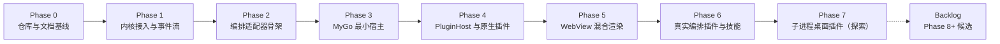

# 路线图：总览

- 状态：定稿
- 日期：2026-10-28
- 关联：ADR-0001 ~ 0007；architecture/01；各 phase 文档

## 1. 阶段总览与看板（本表是**唯一进度看板**）

> 阶段状态只在本表维护。状态变更必须同步 CHANGELOG 与 `.agents/CONTEXT.md`。**最近更新：2026-10-28。**

| 阶段 | 一句话目标 | 参考估时* | 状态 |
|---|---|---|---|
| [Phase 0](phase-0-foundation.md) | 仓库初始化、规范与设计定稿、文档先行落盘 | — | ✅ 完成（2026-10-28，tag `phase-0.end`） |
| [Phase 1](phase-1-kernel-events.md) | 跑通 `sky-valley/pi` 内核与统一事件流，会话可恢复 | 1~2 周 | ✅ 完成（2026-10-28，tag `phase-1.end`） |
| [Phase 2](phase-2-plugin-adapter.md) | 编排适配器骨架与 A 轨运行时选型：三分类、诊断、进程隔离 | 3~4 周 | 未开始 |
| [Phase 3](phase-3-desktop-host.md) | MyGo 最小宿主：实时会话流、输入、取消、设置 | 2~3 周 | 未开始 |
| [Phase 4](phase-4-native-plugins.md) | PluginHost 与首批原生 `ui.View` 插件 | 3~4 周 | 未开始 |
| [Phase 5](phase-5-webview-plugins.md) | WebView 混合渲染与 Diff 审阅插件 | 2~3 周 | 未开始 |
| [Phase 6](phase-6-real-orchestration.md) | 真实 Pi 编排插件接入、三分类矩阵、技能复用、steering 回传 | 3~4 周 | 未开始 |
| [Phase 7](phase-7-dynamic-plugins.md) | 第三方子进程桌面插件（UI 描述模式） | 2~3 周 | 未开始（探索性） |

\* 单人全职参考值，仅量级感知；AI 辅助开发节奏波动大，以验收为准，不赶工期。

## 2. 每阶段通用流程（硬流程，详见 standards/07）

1. **文档定稿**：本阶段 phase 文档及其引用设计稿从草稿转定稿（所有者知情即可，重大技术变更须 ADR）。
2. **实现**：feature 分支开发；规范全程生效；小步提交。
3. **验收**：逐条执行本阶段“验收场景”，结果写入《阶段进度报告》。
4. **收尾**：进度报告 + 更新看板 + CHANGELOG + ADR/架构文档回填 + 体量核对 + 规范复查 + tag（`phase-N.end`）。

阶段可以调整顺序（如 Phase 4 与 Phase 5 互换），但必须先改本文与对应 phase 文档；不允许“做着做着换方向”。

## 3. Backlog（Phase 8+ 候选，立项须先写 ADR）

- **Prompt templates**：上游 pi 有、`sky-valley/pi` 未移植；先补内核能力再开放。
- **MCP**：上游 Go 移植尚未落地 MCP；等待上游或由适配层承接。
- **主题系统**：桌面视觉统一后再做用户主题；不做终端主题兼容。
- **插件市场与签名分发**：manifest、签名、更新、回滚；Phase 7 之后。
- **插件自有窗口模式**：比 UI 描述灵活，但隔离边界弱。
- **多窗口/多会话并排**、会话搜索与跨会话检索。
- **本地模型 provider**（Ollama/llama.cpp 等）。
- **远程执行环境**（复用上游 `env` 子模块）与协同（`chord`）。
- **便携模式**（数据放程序目录）、自动更新通道、i18n。
- **Bedrock / Codex / OAuth**：取决于上游移植与本项目需求，不默认承诺。

## 4. 风险登记簿（跨阶段）

| 风险 | 等级 | 对策 |
|---|---|---|
| `sky-valley/pi` API 漂移 / 破坏性变更 | 高 | 固定提交；上游类型隔离在 `internal/kernel`；升级独立分支 + 全量测试 |
| MyGo v0.x API 漂移与原生 UI 成熟度 | 高 | 锁版本；用法收敛；Phase 3 spike；必要时主壳改 WebView |
| A 轨适配器复杂度（无现成 extensions runtime，需自建 shim 与打包） | 高 | Phase 2 限时 spike 选型（ADR-0008）；只承诺三分类矩阵，不承诺全量兼容 |
| 子进程生命周期与崩溃（含孙进程） | 中 | 进程树清理、心跳、超时、重启上限、故障注入测试 |
| 长会话性能（10k+ 消息、高频 delta） | 中 | 虚拟化列表；delta 合并；UI 背压；性能基准 |
| WebView 三平台差异（焦点/层级/DPI） | 中 | 平台冒烟清单；覆盖层由宿主统一管理 |
| 单点开发、无第二双眼睛 | 中 | 规范 + 门禁 + 每阶段报告披露风险；关键设计先写 ADR |
| 许可证污染（参考 GPL/LGPL 项目） | 低但零容忍 | 只读思路、不复制；评审时检查来源；依赖准入表 |
| 范围膨胀（插件平台先于可用产品） | 中 | 每阶段只做清单内的事；新想法进 backlog |

## 5. 待所有者决策

| 事项 | 当前默认 | 影响 |
|---|---|---|
| 许可证 | MIT（ADR-0007） | 分发与插件生态 |
| 正式产品名 | `Locowrk`（`wrk`，不是 `work`；不加 `-pi`） | 仓库、可执行文件、安装包 |
| Go 模块路径 | `github.com/qingbird1983/locowrk`（module 小写；仓库显示名 `Locowrk`） | import 路径与依赖引用 |
| 主壳渲染路径 | Phase 3 先 WebView，spike 后复核 | 开发成本与体验 |
| A 轨运行时 | Phase 2 限时 spike 后由 ADR-0009 定稿 | 兼容矩阵、打包与分发成本 |
| Windows 之外的首发平台 | 仅保证可构建 | 测试与打包投入 |
